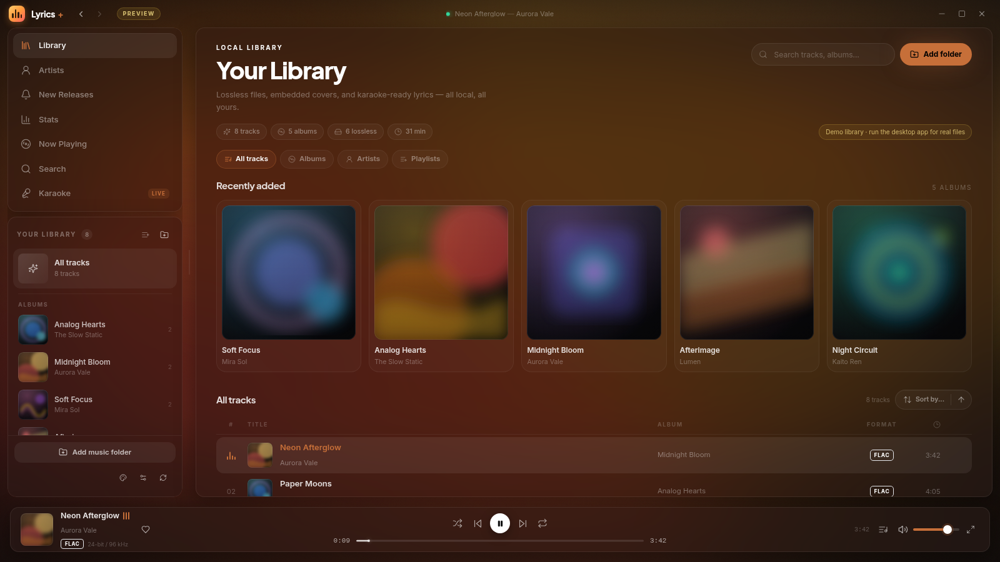
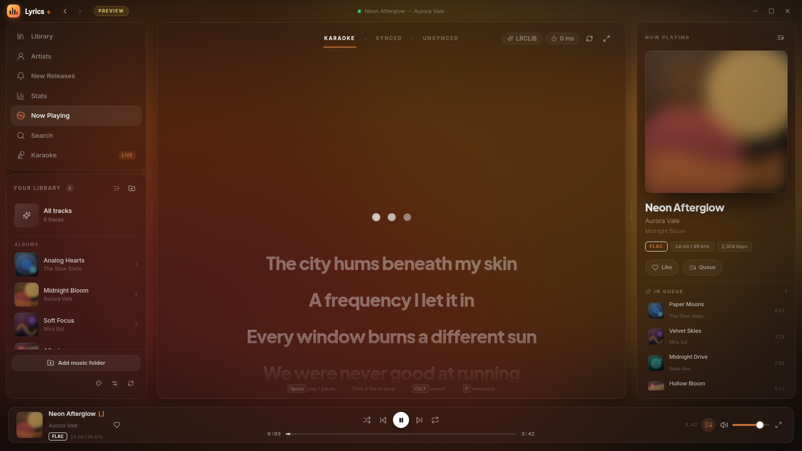
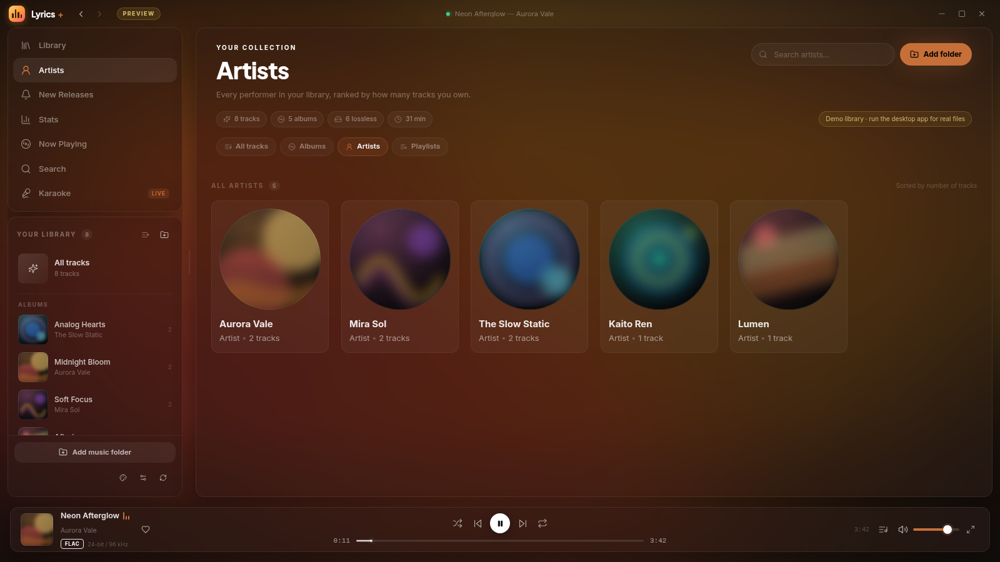
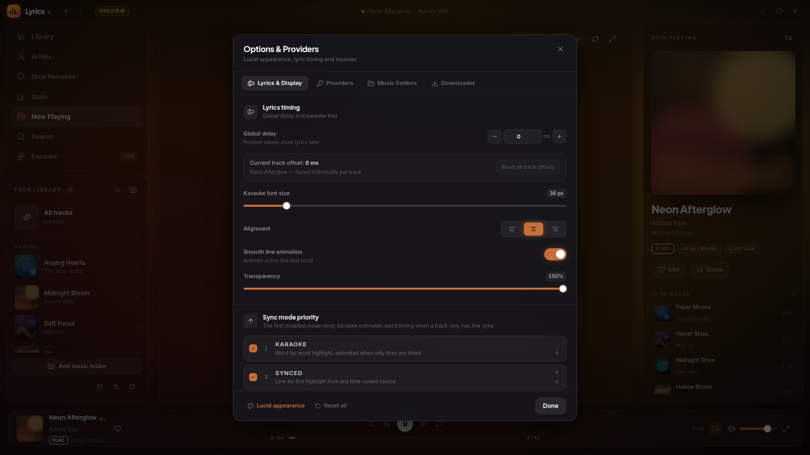

# Lyrics+

[English](README.md) · **Русский**

Локальный десктопный музыкальный плеер для Linux с караоке-лирикой, лентой
релизов Spotify и каскадным lossless-загрузчиком. Построен на
**Electron 45 (Chromium)**, **React 18**, **TypeScript**, **Tailwind**,
**framer-motion** и **Zustand**.


Chromium нативно декодирует FLAC, ALAC, WAV, MP3, Opus, OGG и AAC и выводит
звук через PipeWire/PulseAudio. Без композитора WebKitGTK, без libmpv.

## Скриншоты

| Библиотека | Караоке-лирика |
| --- | --- |
|  |  |
| **Артисты** | **Настройки и провайдеры** |
|  |  |

Скриншоты сняты с демо-библиотеки в браузерном предпросмотре.

## Возможности

- **Аппаратно-ускоренное воспроизведение** — медиапайплайн Chromium, FLAC /
  Hi-Res FLAC / ALAC / WAV / MP3 / OPUS / OGG / M4A / AAC.
- **Караоке-лирика** — построчная и пословная подсветка, клик по строке для
  перехода, плавный центрированный скролл, затухание и индивидуальный сдвиг
  тайминга для каждого трека.
- **Локальная библиотека с несколькими папками** — `music-metadata` читает
  теги, встроенные обложки и лирику. Папки можно добавлять, удалять и
  пересканировать; альбомы, артисты, плейлисты, очередь и недавно добавленные
  треки используют единый индекс.
- **New Releases из Spotify** — подписки на артистов из локального клиента
  Spotify (или из веб-профиля), релизы за последние 28 дней, 30-секундные
  превью и метки непрочитанного в сайдбаре и на карточках.
- **Каскадный lossless-загрузчик** — очередь недостающих треков, живой прогресс,
  отмена задач и автоматическое пересканирование библиотеки после завершения.
  Движок — внешний Python-скрипт, поэтому можно подключить кастомный загрузчик
  для других источников. Эталонный скрипт перебирает Mornye Lossless, Soulseek,
  Deezer, Bandcamp, SoundCloud и YouTube.
- **Статистика прослушивания** — общее время, топ артистов и треков, плюс
  плейлист «All-Time Top» в один клик.
- **Lucid UI** — матовые поверхности, ambient-свечение в цвет обложки,
  опциональный шумовой оверлей, безрамочное окно с собственными элементами
  управления и кроссфейдом.
- **Подробные настройки** — тайминг лирики, размер шрифта, выравнивание,
  прозрачность, компактный режим, цвета, ambient/шум, порядок провайдеров,
  музыкальные папки и пути загрузчика.
- **Пайплайн провайдеров** — включение, сортировка и приоритет источников
  лирики: LRCLIB, Spotify (cookie `sp_dc`), Musixmatch (API-ключ / refresh
  token) и встроенные теги. Локальные `.lrc` всегда в приоритете.
- **Браузерный предпросмотр** — интерфейс работает в обычном браузере с
  демо-библиотекой и симулированным воспроизведением.

## Требования

- Linux с PipeWire, PulseAudio или ALSA (Wayland или X11)
- Node.js 18+ и npm
- Rust-тулчейн не нужен
- Для загрузок опционально: Python 3 и внешний скрипт каскадного загрузчика
  со своими зависимостями
- Для релизов и лирики Spotify опционально: аккаунт Spotify, авторизованный
  через Настройки → Провайдеры

## Запуск

```bash
npm install
npm run dev
```

`npm run dev` запускает Vite и автоматически открывает Electron.

### Браузерный предпросмотр

Откройте `http://localhost:1420`, пока работает Vite. В заголовке окна будет
бейдж **Preview**, а приложение использует демо-библиотеку. В браузере звук не
воспроизводится.

### Продакшен-сборка

```bash
npm run build        # typecheck + Vite + electron-builder
npm run build:app    # typecheck + Vite only
npm run dist         # electron-builder (AppImage + deb)
```

Сборки складываются в `release/`.

## Как пользоваться

1. Нажмите **Add music folder** (или **Add folder** в шапке библиотеки) и
   выберите папку. Сканер обойдёт её рекурсивно. Повторите, чтобы добавить
   несколько источников.
2. Нажмите на трек, чтобы начать воспроизведение и открыть караоке-вид.
3. Положите `.lrc` рядом с аудиофайлом, чтобы использовать локальную
   синхронизированную лирику. Поддерживаются расширенные word-теги LRC
   (`<mm:ss.xx>`).
4. Откройте **New Releases**, чтобы посмотреть свежие релизы отслеживаемых
   артистов. Сначала подключите Spotify в **Настройки → Провайдеры**, затем
   нажмите **Sync** для обновления ленты. Отсутствующие локально треки можно
   отправить в очередь загрузки.
5. Настройте загрузчик в **Настройки → Downloader**: путь к Python/venv, путь
   к скрипту и папку для готовой музыки. Можно указать свой кастомный скрипт
   для скачивания музыки с разных источников.
6. Откройте **Настройки** (шестерёнка внизу сайдбара), чтобы настроить лирику,
   папки, провайдеров и загрузки.

### Музыкальные папки

Удаление папки отвязывает её от Lyrics+ и удаляет её треки из базы библиотеки.
Аудиофайлы на диске при этом не удаляются.

### Горячие клавиши

| Клавиша | Действие |
| --- | --- |
| `Space` | Воспроизведение / пауза |
| `←` / `→` | Перемотка −5 с / +5 с (`Shift` = 15 с) |
| `↑` / `↓` | Громкость ±5% |
| `N` / `P` | Следующий / предыдущий трек |
| `M` | Без звука |
| `F` | Иммерсивная лирика (скрыть боковые панели) |
| `Q` | Показать / скрыть очередь |
| `L` | Переключить Library / Now Playing |
| `/` | Перейти к поиску по библиотеке |
| `Esc` | Закрыть очередь / настройки или выйти из иммерсивного режима |

## Настройки

Настройки хранятся в `library.json` в user-data директории Electron
(`~/.config/lyrics-plus-player/library.json` на Linux) и применяются сразу.

### Лирика и отображение

- **Глобальная задержка** — сдвиг тайминга от −2000 до +2000 мс.
- **Сдвиг для трека** — сохраняется отдельно для текущего трека.
- **Размер шрифта караоке** — 32–64 px.
- **Выравнивание** — слева, по центру или справа.
- **Прозрачность** — общая непрозрачность текста лирики.
- **Компактный режим** — строки до/после активной и опциональное затухание.
- **Визуал** — цветной ambient-фон, шумовой оверлей, интенсивность свечения и
  свои цвета активного/неактивного текста и акцента.

### Провайдеры

Провайдеры опрашиваются сверху вниз. Стрелками меняйте порядок, чекбоксом
включайте и отключайте. Побеждает первый провайдер, который вернул
синхронизированную лирику; plain-текст используется, только если ни один
провайдер не дал таймкодов.

1. **LRCLIB** — бесплатно, ключ не нужен.
2. **Spotify** — нужен cookie `sp_dc` авторизованного аккаунта. Приложение
   находит трек через Spotify Search API и читает Color Lyrics.
3. **Musixmatch** — API-ключ разработчика или refresh token.
4. **Встроенные теги** — FLAC Vorbis `LYRICS`, ID3 `USLT`/`SYLT`.

Локальные `.lrc` проверяются раньше любого провайдера. Неудачный онлайн-запрос
никогда не блокирует воспроизведение.

### Музыкальные папки

Добавляйте и удаляйте корневые папки библиотеки, смотрите количество треков в
каждой и пересканируйте все источники одной кнопкой. Удаление источника не
удаляет файлы с диска.

### Downloader

- **Python / venv path** — интерпретатор для запуска скрипта загрузчика.
- **Downloader script path** — совместимый каскадный скрипт. По умолчанию путь
  пустой, поэтому задайте его до постановки загрузок в очередь.
- **Music directory** — куда писать готовые файлы. По умолчанию
  `~/StreamripDownloads`.

**Кастомные скрипты.** Lyrics+ не привязан к конкретному сервису скачивания.
Можно добавить любой Python-скрипт, если он принимает текстовый файл со ссылками
первым аргументом, складывает готовые файлы в настроенную музыкальную папку и
печатает прогресс в stdout.

Прогресс парсится из вывода скрипта. По завершении запускается пересканирование
библиотеки и обновляются метки загрузок в New Releases.

## Архитектура

```
electron/
  main.ts        окно, IPC, диалоги, протокол media://, ручки изменения размера
  preload.ts     sandboxed contextBridge API (CommonJS)
  scanner.ts     сканер music-metadata, стабильные 52-битные id, кэш обложек
  lyrics.ts      sidecar → пайплайн провайдеров → JSON-кэш
  media.ts       протокол media:// для аудио и обложек с поддержкой Range
  store.ts       JSON-персистентность библиотеки/настроек/лирики
  downloader.ts  внешний процесс загрузчика, очередь, парсинг прогресса
  releases.ts    лента релизов Spotify, превью, статус загрузок
  spotify-auth.cjs   захват и хранение cookie Spotify
  spotify-desktop.ts чтение локальной коллекции Spotify (отслеживаемые артисты)
  spotify-web.ts     GraphQL-клиент web-плеера (дискография, альбомы)
  track-names.ts     нормализация имён артистов и названий
src/
  App.tsx        оболочка приложения, переходы между видами, горячие клавиши
  components/
    artists/     сетка артистов и карточка артиста
    background/  ambient-фон в цвет обложки, шумовой оверлей
    layout/      кастомный заголовок, сайдбар
    library/     сетка библиотеки, строки треков
    lyrics/      вкладки, анимации строк, центрированный скролл
    player/      now playing, панель плеера, очередь
    releases/    лента New Releases и drawer загрузок
    settings/    модальное окно Options & Providers
    stats/       статистика прослушивания
    ui/          обложки, кнопки, тосты, эквалайзер
  data/          демо-библиотека для браузерного предпросмотра
  hooks/         плавная позиция 60 fps, палитра обложки
  lib/           Electron bridge, AudioEngine, LRC-парсер, цвета
  store/         Zustand-сторы плеера, настроек, релизов, загрузок и тостов
docs/
  screenshots/   скриншоты для README
```

### Контракт воспроизведения

Рендерер владеет воспроизведением через один `HTMLAudioElement`. Он отправляет
снапшот каждые 33 мс с
`{ path, positionMs, durationMs, paused, volume, eof, bitPerfect }`;
событие `ended` срабатывает один раз на трек. Главный процесс отвечает только за
файлы, диалоги, сканирование, лирику, релизы, загрузки и протокол `media://`.

ID треков — стабильные 52-битные FNV-1a хэши пути к файлу. Обложки пишутся в
`$XDG_CONFIG_HOME/lyrics-plus-player/covers` и отдаются через `media://`.

## Заметки

- **Безрамочное окно** — перетаскивайте за заголовок, меняйте размер с любого
  края.
- **Wayland** — Chromium запускается с `UseOzonePlatform` и
  `--ozone-platform=wayland`, если задан `WAYLAND_DISPLAY`.
- **Sandbox** — `contextIsolation: true`, `nodeIntegration: false`,
  `sandbox: true`; preload собирается как CommonJS.
- **Legacy Tauri backend** — архив в `legacy-tauri/`, только для справки.

## Решение проблем

- **Пустое окно** — запустите `npm run dev` и смотрите терминал; лог рендерера
  дублируется в разработке.
- **Нет обложек** — извлекаются только встроенные обложки. Встройте арт в файл
  или расширьте `electron/scanner.ts`.
- **Нет онлайн-лирики** — проверьте доступ к `lrclib.net`; запросы отправляются
  с описательным `User-Agent`. Включите нужные провайдеры в настройках.
- **Провайдер Spotify пуст** — cookie `sp_dc` истекают; вставьте свежее значение.
- **New Releases пусто** — авторизуйтесь в Настройки → Провайдеры и нажмите
  **Sync**. Лента показывает релизы за последние 28 дней; у артистов без свежих
  релизов будет пусто.
- **Загрузки не начинаются** — задайте пути к Python и скрипту в Настройки →
  Downloader. Скрипт должен существовать, а его Python-зависимости — быть
  установлены для выбранного интерпретатора.
